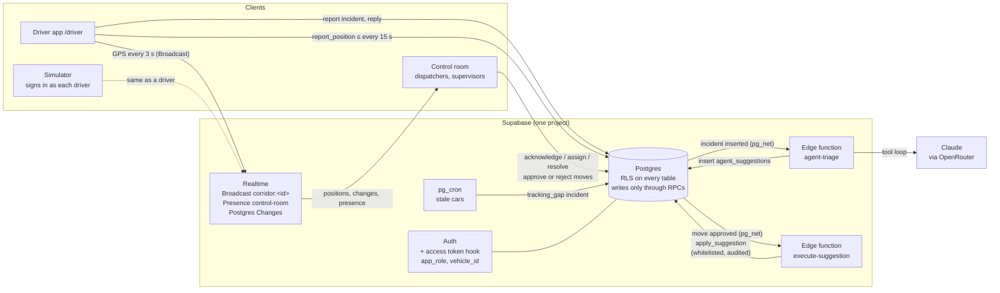

# The Car Delivery Control Room

Our entry for Bahn's challenge at the Prompt Operations Hackathon, 24 to 25
October 2026. Hand-in is Sunday 25 October, 15:00. The challenge brief is in
`PARTICIPANT-BRIEF.md`.

Live: https://aaltoes-operations-hackathon-starte-tau.vercel.app/

Everything in this repo is made up. No real people, cars, companies or
messages, and nothing in the app contacts anyone.

## The problem

Bahn delivers used cars for dealers. A freelance driver collects each car from
the seller and drives it, often across a border and onto a ferry, to the
dealer. About 50 people in operations run over 25,000 deliveries a year by
phone, email and paperwork. Things go wrong every hour (a missed train, a car
that is not ready, a sold-out ferry, a missing document) and each one starts a
chain that someone has to hold in their head. `OPERATIONS-CONTEXT.md` describes
how the work actually goes.

## What we are building

A control room where people and agents work together to get every car
delivered:

- It shows a person **only the orders that need them**, ranked by risk and by
  the clock that decides them, and says why. Of 100 orders, about 43 need
  someone; the rest stay out of the way.
- Opening an order brings it down to **one decision**: what happened, what an
  agent found or proposes, the evidence behind it, and exactly what happens if
  you approve, change or reject it. Every decision can be undone.
- **Agents do the legwork, people make the judgement calls.** How much each
  agent may do on its own is set per kind of action. Two rules are fixed:
  looking things up and asking drivers or sites needs no approval, and an agent
  never contacts a customer.

Judging (from the brief): the control room itself 40%, how we worked with AI
30%, taste 30%. `BUILD-LOG.md` is our record for the middle one; keep appending
to it.

### In scope

- The control room web app (v2, deployed): queue, order page, inbox, agents
  and autonomy, all orders. Described in detail in
  `apps/control-room/README.md`.
- **Live operations** (inside the control room: the map, KPIs and incident
  queue on Needs you, each car's incidents and driver chat on its order page): cars moving on a map,
  incidents from drivers and the system, and a helper agent that looks into
  each incident and proposes moves (for a missed ferry: rebook the sailing,
  book the driver a hotel), each approved or rejected by a person.
- The **driver app** (`apps/driver`, served at `/driver`): the driver's car and
  shift, location sharing, one-tap reports, messages from control.
- A shared Supabase backend: the read-only packet snapshot plus decisions, and
  a live operations schema for the driver app and the helper agent (see
  below and `supabase/README.md`).
- Shared code (`packages/shared`) and a simulator that drives the demo fleet
  along corridors (`tools/simulator`).

### Out of scope

- Contacting anyone for real (email, SMS, phone). Outgoing messages are drafts
  or rows in the database.
- Real booking, payment or ferry integrations.
- Real customer data. The packet in `dataset/` and `attachments/` is the only
  source.

## Repo layout

| Path | What it is |
| --- | --- |
| `apps/control-room/` | The control room (v2 with live operations): Vite, React 19, strict TypeScript, React Router, plain CSS, Supabase, Leaflet. Deployed at `/`. |
| `apps/driver/` | The driver app: Vite, React 19, a phone-first PWA. Deployed at `/driver`. |
| `packages/shared/` | Generated database types, the Supabase client, realtime channel names, position publishing. |
| `tools/simulator/` | Signs in as each demo driver and moves the fleet; adds delays and random incidents. |
| `supabase/` | Migrations (applied in name order to one hosted project), `seed.sql`, pgTAP tests, edge functions, `config.toml`. `supabase/README.md` has the access rules. |
| `dataset/` | The packet: 100 made-up orders and everything around them, as JSONL. `dataset/SCHEMA.md` explains every field and the evidence rules. |
| `attachments/` | Made-up documents, receipts and photos, with SHA-256s in `attachments/manifest.json`. |
| `starter/` | v1: Bahn's Next.js starter that we extended first. Kept for reference only; v2 does not import from it. |
| `mockups/` | Screenshots of the original starter, for the brand feel. |
| `BUILD-LOG.md` | How we worked with Claude Code: what we asked, checked and threw away. |
| `REBUILD-PROMPT.md` | The prompt that specified the v2 rebuild. The clearest statement of the product rules. |
| `check_packet.py` | Checks the packet itself. |

The repo is an npm workspaces monorepo (root `package.json`: `apps/*`,
`packages/*`, `tools/*`); run `npm install` once at the root. `vercel.json`
deploys two services from one Vercel project: the control room at `/` and the
driver app at `/driver`.

## Backend

One hosted Supabase project (ref `vtwvdnprbricautvphic`, also in `.mcp.json`).
There is no local Docker or Supabase CLI on the main dev machine: write
migrations as files in `supabase/migrations/` and verify against the remote.

**The snapshot and decisions** (serve the live app; do not drop or alter
without explicit agreement):

- `records(collection, id, order_id, data)`: every packet row, unchanged and
  read-only.
- `decisions`, `autonomy`: what people decided and how much agents may do.
- Writes only through `security definer` functions `decide`, `undo_decision`
  and `set_autonomy`. The anonymous key can read and never write. A second
  decision on the same item is refused with HTTP 409.
- Changes stream to the app through Supabase Realtime.

**The live operations schema** (`supabase/migrations/20261024141938_ops_schema.sql`
and the `ops_*` migrations after it, all additive): shared by the control room,
the driver app and the helper agent. Vocabulary:

- A **corridor** is a route cars are driven along (a generic brief's "line").
- A **vehicle** is the car being delivered, not a company van. Its id is the
  dataset's car id (`veh-00004`) and it links to the order (`ord-00004`,
  `CD-420004`).
- An **assignment** puts a driver on one car for a shift.
- `profiles` carry a role: `driver`, `dispatcher` or `supervisor`. RLS reads it
  from JWT claims set by `custom_access_token_hook`.
- `incidents` (reported by a driver, control, an agent or the system),
  `messages` (to exactly one user, vehicle or corridor),
  `agent_suggestions` (pending until a person approves or rejects them) and an
  append-only `audit_log`.

How the pieces fit:



- The agent only proposes. Each move is approved on its own, then carried out
  by `apply_suggestion`, which knows a fixed list of moves and writes the
  audit log.
- Only the edge functions hold the service-role key; the model key is a
  Supabase secret (`OPENROUTER_API_KEY`). The apps get the project URL and
  the publishable key, nothing else.
- Drivers see only their own car, messages and reports, and can send their
  position only on their own corridor. The full role table, the realtime
  channels and the 95 pgTAP checks are in `supabase/README.md`.

## Rules every change must keep

These come from `dataset/SCHEMA.md` and the brief. Breaking one is a bug.

- **The clock is frozen** at `dataset/data/manifest.json`'s `snapshot_at` on
  the snapshot screens. Every "in 2 h" or "3 h ago" there is measured from it,
  never from the real clock. Live operations (the live blocks in the control room, the driver app, the
  agent) run on the real clock.
- **Evidence:** a quote is not a booking, and a booking is not a boarding. An
  acknowledged alert is still open. A message is a claim by its speaker.
  Inbox candidates are guesses until a person links one. Only a recorded
  effect event counts as a change. Stage is derived from status, offers and
  assignments; `display_lane` is never read.
- **The customer rule:** an agent never contacts anyone who pays. A person may
  send a draft the agent wrote.
- **Derivation lives in `src/domain/`** as pure, tested functions. Components
  only display.
- **Nothing is invented.** A next step comes from the record, then an agent
  proposal, then our playbook, and says which.
- Secrets stay in `.env` (git-ignored). The service-role key is used only by
  the seed script and never reaches the browser.
- `.gitattributes` keeps `dataset/` and `attachments/` byte-exact. Do not let
  line endings be converted; the seed checks every hash.

## Run and check it

Node.js 24 or newer. From the repo root, once: `npm install`, then copy
`apps/control-room/.env.example` and `apps/driver/.env.example` to `.env` in
the same folders, and `.env.example` to `.env` at the root (for the simulator).
Then, each in its own terminal:

```sh
npm run dev:control-room      # http://localhost:5173  (sign in on Needs you for live operations)
npm run dev:driver            # http://localhost:5175
npm run simulate              # moves the fleet; Ctrl+C to stop
```

Seeding the snapshot and the control room's own checks (`npm run check:db`,
`npm run test:e2e`, `npm run screens`) are in `apps/control-room/README.md`;
the backend's seed and pgTAP tests are in `supabase/README.md`.

```sh
npm test                      # every workspace's unit tests
npm run typecheck             # every workspace
```

Run the tests and typecheck before every commit. Run the control room's e2e
test before anything that touches the queue, the order page or `decide()`.

### Environment variables

| Where | Variable | What |
| --- | --- | --- |
| `apps/control-room/.env`, `apps/driver/.env` (and Vercel) | `VITE_SUPABASE_URL` | Project URL |
| | `VITE_SUPABASE_ANON_KEY` | Publishable (or legacy anon) key. Public by design |
| `apps/control-room/.env` | `SUPABASE_SERVICE_ROLE_KEY` | Only for `npm run seed` of the snapshot. Never prefixed `VITE_` |
| root `.env` (simulator) | `SUPABASE_URL`, `SUPABASE_PUBLISHABLE_KEY` | As above |
| | `DEMO_PASSWORD` | Password of the seeded `@demo.bahn.test` users. Ask the team; it is not in the repo |
| Supabase secrets (edge functions) | `OPENROUTER_API_KEY` | Model access for `agent-triage` |
| | `OPENROUTER_MODEL` | Optional, default `anthropic/claude-opus-5.5` |
| Simulator, optional | `SIM_SPEED`, `SIM_INCIDENT_EVERY_S` | Speed (default 30× real time); seconds between random incidents (default 240, `0` for none; each one wakes the agent) |

## Deploy

- **Database**: migrations in `supabase/migrations`, applied in order. One-time
  steps for a new project (seed with your own password, Vault `project_url`,
  function secrets, the access token hook) are in `supabase/README.md`.
- **Edge functions**: `agent-triage` and `execute-suggestion`, deployed with
  JWT verification off (they check their own secret from Vault).
- **Apps**: one Vercel project, two services in `vercel.json`: the control room
  at `/` and the driver app at `/driver`. Both read `VITE_SUPABASE_URL` and
  `VITE_SUPABASE_ANON_KEY` from the Vercel project's environment at build time.

## Demo accounts

Every account below exists on the hosted project and in `supabase/seed.sql`.
They all share one password. The repo is public, so the hosted project's
password is not written here: ask the team, or read `DEMO_PASSWORD` in the
root `.env` on a machine that has it. On a local stack the password is
`bahn-demo-local`.

Staff sign in to the control room on Needs you (the "On the road now" block):

| Role | Name | Email |
| --- | --- | --- |
| Supervisor | Helena Starkwood | `helena.starkwood@demo.bahn.test` |
| Dispatcher | Mira Kestelund | `mira.kestelund@demo.bahn.test` |
| Dispatcher | Oskar Brennvik | `oskar.brennvik@demo.bahn.test` |

Drivers sign in to the driver app at `/driver`. Each is on one car:

| Driver | Email | Car | Corridor |
| --- | --- | --- | --- |
| Leo Quellford | `leo.quellford@demo.bahn.test` | Bentley Continental GT (`CD-420584`): **the ferry-miss scenario** | Helsinki – Travemünde ferry – Hamburg |
| Kasper Kovelund | `kasper.kovelund@demo.bahn.test` | Bentley Continental GT (`CD-420322`), on the ferry | Helsinki – Travemünde ferry – Hamburg |
| Jenna Erdalen | `jenna.erdalen@demo.bahn.test` | Ferrari 296 GTB (`CD-420338`) | Helsinki – Travemünde ferry – Hamburg |
| Zoe Bergalund | `zoe.bergalund@demo.bahn.test` | Bentley Continental GT (`CD-420452`) | Helsinki – Tampere – Turku |
| Daniel Arelmont | `daniel.arelmont@demo.bahn.test` | Ferrari 296 GTB (`CD-421013`) | Helsinki – Tampere – Turku |
| Hanna Wenverin | `hanna.wenverin@demo.bahn.test` | Volkswagen Golf (`CD-420384`), waiting for pickup | Helsinki – Tampere – Turku |
| Sofia Lundervik | `sofia.lundervik@demo.bahn.test` | BMW M4 (`CD-420366`) | Helsinki – Lahti – Oulu |
| Rafael Rillavik | `rafael.rillavik@demo.bahn.test` | Ferrari 296 GTB (`CD-420806`) | Helsinki – Lahti – Oulu |
| Kasper Carvell | `kasper.carvell@demo.bahn.test` | Porsche 911 Carrera (`CD-420145`) | Helsinki – Lahti – Oulu |
| Rafael Venwick | `rafael.venwick@demo.bahn.test` | Mercedes-Benz S-Class (`CD-420917`) | Helsinki – Lahti – Oulu |
| William Mervalen | `william.mervalen@demo.bahn.test` | Bentley Continental GT (`CD-420537`) | Malmö – Copenhagen – Rødby ferry – Hamburg |
| Nadia Halverick | `nadia.halverick@demo.bahn.test` | Mercedes-Benz EQE (`CD-420324`) | Malmö – Copenhagen – Rødby ferry – Hamburg |
| Cole Mervalen | `cole.mervalen@demo.bahn.test` | Porsche Taycan (`CD-420735`) | Hamburg – Frankfurt – Munich |
| Selma Talverick | `selma.talverick@demo.bahn.test` | Audi Q8 e-tron (`CD-420071`) | Hamburg – Frankfurt – Munich |
| Elias Halverick | `elias.halverick@demo.bahn.test` | Porsche Macan (`CD-421024`), waiting for pickup | Hamburg – Frankfurt – Munich |

The simulator signs in as all fifteen drivers, so a driver you are using by
hand will also be moved by it while it runs.

## A 3-minute demo

Two windows side by side: the control room's Needs you signed in as a
dispatcher (`mira.kestelund@demo.bahn.test`), and the driver app at `/driver`
at phone size signed in as Leo (`leo.quellford@demo.bahn.test`). Start
`npm run simulate` a minute before.

1. **The room (30 s).** Cars move on their corridors in real time: Helsinki to
   Oulu, the Travemünde ferry, Copenhagen to Hamburg. The line under
   "On the road now" shows on-time share, open incidents and time to acknowledge. Sign in as Oskar in a
   second window and each sees the other on shift, and which incident they
   have open.
2. **A driver reports (45 s).** In Leo's app tap Report → Traffic or delay,
   type "Stau on the A1", send. It appears at the top of Mira's incident queue;
   click it to open the car's order page. Within half a minute the agent's proposal is in: what it checked, and one or two
   moves. Approve the message: it arrives in Leo's inbox.
3. **The ferry miss (75 s).** Click **Simulate ferry traffic jam**. Leo's
   Bentley is in a Stau near Bargteheide, booked on tonight's sailing from
   Travemünde. The agent checks the ETA against check-in (misses by about half
   an hour), finds the next sailing with space and the cheapest hotel near the
   port, and proposes **rebook the ferry** and **book a room**, with their
   costs. Open "What the agent checked". Approve each move; each turns into a
   ✓, Leo gets both messages, and the card reads "Recovered".
4. **Who may do what (30 s).** Approving a car status change needs a
   supervisor. Drivers never see other cars. Every decision is in the audit
   log with who made it.
